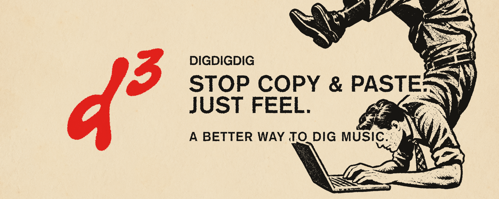

  

  

<h3 align="center">DIG³</h3>

A digging tool for DJs and music lovers.

---

Found a track on one platform? Search for it on another — without copying and pasting.
DIG³ adds search links directly to track listings on supported sites. Click a link, get results in a new tab. That's it.

  

## Supported sites

| Site | Source | Search destination |
| --- | --- | --- |
| Beatport | O | O |
| Soundeo | O | O |
| YouTube | O (Music cards) | O |
| Bandcamp | — | O |

## How it works

1. Open a track list on Beatport, Soundeo, or a YouTube video with a Music card.
2. DIG³ adds search links below each track.
3. Click a link to open search results on the destination site.

No account. No server. No data leaves your browser.

## Privacy

Read the full privacy policy at [https://kimjihyun00.github.io/digdigdig-page/](https://kimjihyun00.github.io/digdigdig-page/).

## Contact

[cozihyun@gmail.com](mailto:cozihyun@gmail.com)

---

<strong>KEEP DIGGING.</strong>

